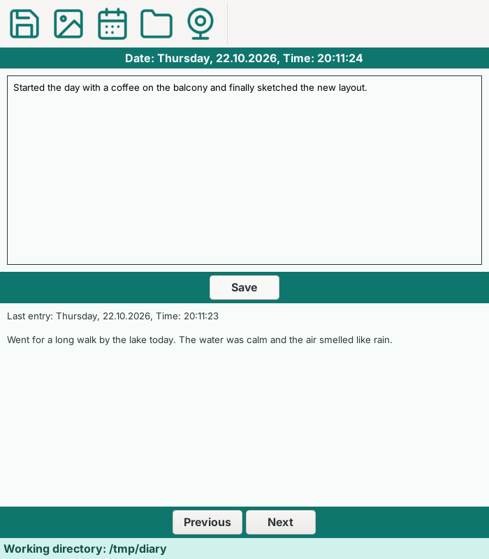
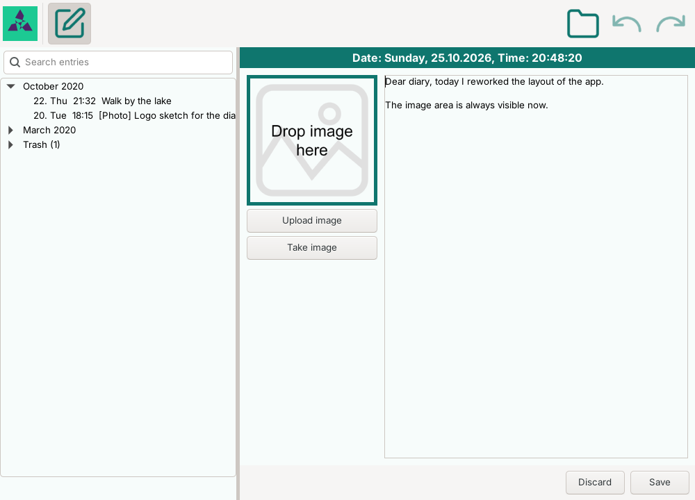

# StoryTime

Digital diary written in python using wxPython.
Works completely offline, so there are no privacy issues.
On the other hand side, there is no backup included. 
Therefore, one has to take care of backing up the data manually.

## Installation

Can be installed using pip as follows:

```
$ pip install story-time
```

## Running

Requires python version >= 3.9.
To run it, just type the following command into
the command line:

```
$ story-time
```

## Settings

The chosen data folder is stored in `settings.json` in the config folder of the
user (`~/.config/StoryTime` on Linux, `%APPDATA%\StoryTime` on Windows,
`~/Library/Application Support/StoryTime` on macOS). It survives updates of the
app. The folder of older versions (`Info.txt` in the package) is taken over
automatically. Taken photos are kept in a temporary folder until they are saved.

## Keyboard shortcuts

| Keys | Action |
| --- | --- |
| Ctrl+N | Write a new entry, or go back to reading |
| Ctrl+S | Save the entry |
| Ctrl+P | Switch between text-only and photo mode |
| Ctrl+D | Choose another date and time |
| Ctrl+O | Choose another data folder |
| Ctrl+T | Take a selfie with the webcam |
| Ctrl+Q | Quit |
| Alt+Left / Alt+Right | Previous (older) / next (newer) entry |
| Left / Right | Previous / next entry, if the cursor is not in the text input or the list |

The shortcuts are also shown in the tooltips of the toolbar.

## Languages

All texts of the user interface are in the catalogs in `story_time/locales`
(currently English and German). The language is taken from the system or
can be set with the environment variable `STORY_TIME_LANG`, e.g.
`STORY_TIME_LANG=de story-time`.

To add a language, copy `en.json` to `<language code>.json` and translate
the values. Keep the keys and the `{placeholders}`, missing texts fall back
to English. In the code, use `tr("some.key")` from `story_time.texts` instead
of writing texts directly.

## Development

Install the package with the development tools and run the checks:

```
$ pip install -e ".[dev]"
$ pytest tests
$ ruff check .
$ black --check .
```

### Code structure

The logic is kept apart from the GUI, so most of it can be tested without one:

| Module | Content | Uses wx |
| --- | --- | --- |
| `controller.py` | `DiaryController`: what happens when the user writes, reads, searches, saves... | no |
| `dates.py`, `images.py`, `folders.py`, `settings.py`, `shortcuts.py`, `texts.py` | Helpers for dates, image files, folders, settings, keys and texts | no |
| `XML_write.py` | Reading and writing of the XML files with the entries | no |
| `user_interface.py` | The main window, which shows what the controller says and passes on what the user does | yes |
| `dialogs.py`, `util.py` | The dialogs, colors, fonts and image helpers | yes |

The controller talks to the window through the small interface `View` and asks
the user through `Dialogs` (both in `controller.py`). The real ones are the
main window and `WxDialogs`, the tests of the controller use the fakes in
`tests/fakes.py`. `tests/test_pure_modules.py` checks that the modules without
wx do not import it.

The tests of the main window and of the dialogs open real windows, so on a
headless machine run them under a virtual display, e.g. with `xvfb-run`.
Tests that need a webcam are skipped if none is available.

The toolbar icons are drawn as SVG files in `story_time/Icons/src`.
After changing one, re-render the PNGs the app loads with
`python tools/render_icons.py` (needs `playwright`).

## Usage

The entries are listed on the left, grouped by month, with a search field on
top. Click an entry to read it. The first tool of the toolbar (or Ctrl+N)
switches to writing a new entry, and back. The other tools (save, photo mode,
date, selfie) are only active while writing.

## Screenshots

Reading an entry:



Writing a new entry:



